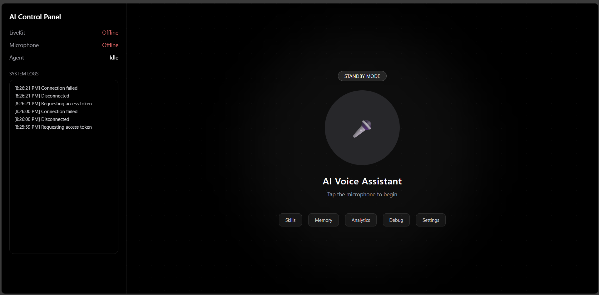

# 🎙️ AI Voice Assistant  
🚧 **WORK IN PROGRESS — ACTIVE DEVELOPMENT** 

  <a href="https://meek-jalebi-225f5c.netlify.app/" target="_blank">
    🔴 <b>LIVE DEMO</b> — Click to Experience the System
  </a>

  
    https://meek-jalebi-225f5c.netlify.app/  
    (<i>backup URL</i>)
  

> A real-time, cross-platform **AI Voice Assistant platform** built with  
> **LiveKit · React (Vite + Tailwind) · Python Voice Agents**

This repository represents a **live system under active engineering**, not a static demo.

---

## ✨ Project Vision

This project aims to build a **next-generation voice interface** that feels:

- 🎧 **Instant & real-time**
- 🧠 **Intelligent & contextual**
- 🎨 **Visually alive**
- 🔌 **Extensible & model-agnostic**
- 🚀 **Production-ready**

It is designed as a **foundation**, not a one-off experiment.

---

## ⚠️ Important Notice

> **Note:** Local virtual environments (`lk/`), models, and secrets are intentionally excluded.

This repository is safe to share publicly and follows clean security practices.

---

## 🧪 Current Work (In Progress)

### 📸 Live UI Preview (Current Build)

> This screenshot reflects the **current working state** of the system.  
> UI will continue evolving as features and animations are added.

---

### 🎨 UI & Experience Enhancements
- Left-side **system logs panel**
- Real-time **LiveKit connection status**
  - 🟢 Connected  
  - 🔴 Disconnected
- Central **voice control area**
- Mic **ON / OFF toggle**
- Listening & speaking **visual animations**
- Live feedback when AI is processing
- Dark, minimal, modern design language

---

### 🎤 Voice Interaction Improvements
- Smooth mic activation & shutdown
- Stable audio lifecycle
- Improved listening → speaking transitions
- Reduced perceived latency
- More natural conversational flow

---

### 🧱 Engineering & Stability
- Dependency cleanup
- LiveKit SDK alignment
- Token lifecycle stabilization
- Build reliability improvements
- Better dev experience during iteration

---

## 🚀 Future Work (Planned Roadmap)

### 🧠 AI & Intelligence (Major Focus)
- **Multiple AI model support**
  - OpenAI GPT models
  - Open-source / local LLMs
  - Cloud-agnostic providers
- Context-aware conversations
- Multi-turn dialogue memory
- Intent detection & command routing
- Tool calling & action execution

> The system will **not be locked** to a single AI provider.

---

### 🎛 Advanced UI & Visual Depth
- Animated audio waveforms
- Speaking / listening glow effects
- Live “thinking” indicators
- Modular dashboard layout
- Theme & layout customization
- Rich, immersive, **“alive” UI feel**

---

### 🌍 Platform & Product Expansion
- Multi-room support
- Multi-user sessions
- Role-based permissions
- Conversation logs & analytics
- Plugin-based agent architecture
- Enterprise-ready extensibility

---

### 📱 Mobile Expansion (Planned)
- **Flutter-based mobile apps**
- Native **iOS & Android support**
- Shared backend & AI logic
- Mobile-optimized voice UX
- Consistent design across platforms

---

### ☁ Deployment & Scale
- Netlify frontend hosting
- Cloud backend deployment
- CI/CD pipelines
- Environment-based builds
- Production monitoring & logging

---

## 🛠 Setup Overview (High Level)

### Backend
1. Create Python virtual environment
2. Install dependencies
3. Configure `.env`
4. Start token server
5. Run LiveKit agent worker

### Frontend
1. Install dependencies
2. Run Vite dev server
3. Fetch token & connect to LiveKit

> Detailed setup is intentionally kept clean and minimal.

---

## 🔒 Security & Best Practices
- No API keys in frontend
- Short-lived scoped tokens
- Secrets via environment variables
- Safe for public GitHub repositories
- Production-minded architecture

---

## 💼 Why This Project Matters

This project demonstrates:

- Real-time communication systems
- Audio & streaming pipelines
- Clean frontend/backend separation
- UI + backend balance
- Long-term product thinking
- Professional debugging & iteration

This is **how real products are built**, not just demos.

---

## 🧭 Status Summary

| Area                | Status |
|---------------------|--------|
| LiveKit Core        | ✅ Stable |
| Voice Agent         | ✅ Working |
| Token Authentication| ✅ Working |
| Base UI             | ✅ Working |
| Advanced UI         | 🚧 In Progress |
| AI Intelligence     | 🚧 Planned |
| Mobile (Flutter)    | 🚧 Planned |
| Deployment          | 🚧 Planned |

---

## 📌 Final Note

> This repository intentionally reflects **real engineering work in motion** — including iteration, debugging, and growth.

It is meant to show **how serious systems evolve**, not just their final state.

---

### 🔥 Next Milestones
- Enhance UI animations & feedback
- Add AI model abstraction layer
- Begin Flutter mobile groundwork
- Prepare production deployments

🚀 **This system is just getting started.**
